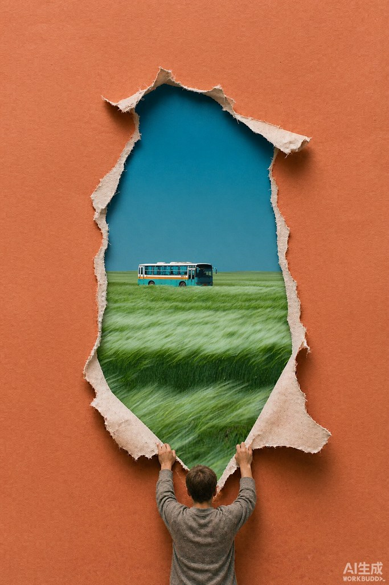

# torn-paper-collage 📄→🌄

> 撕纸拼贴（Torn Paper Collage）风格分析与同风格图片生成 —— WorkBuddy Skill

纯色哑光纸面被撕开，破洞后露出真实的摄影风景/插画，形成超现实的"纸上藏着另一个世界"效果。



## ✨ 功能

- **风格分析**：按 6 个维度（纸面基底 / 撕口形态 / 洞内内容 / 人物互动 / 色彩对比 / 整体气质）结构化总结参考图风格
- **同风格生成**：调用 ImageGen 将指定主体图（或文字描述的场景）合成为撕纸拼贴风格图片
- **实战经验沉淀**：内置 9 例生成验证 + 踩坑修复记录 + 配色速查表

## 📦 安装

将 `torn-paper-collage/` 目录复制到：

- 用户级：`~/.workbuddy/skills/torn-paper-collage/`（推荐）
- 项目级：`.workbuddy/skills/torn-paper-collage/`

或直接把 `torn-paper-collage.zip` 导入 WorkBuddy 的技能管理。

## 🗂️ 文件结构

```
torn-paper-collage/
├── SKILL.md                    # 工作流程：区分素材 → 风格分析 → ImageGen 生成 → 校验交付
└── references/
    └── style-cases.md          # 案例库：参考图分析、9 例实战验证、踩坑记录、配色速查
```

## 🎨 核心风格要素

1. 纯色哑光纸面占画面 60-80%
2. 撕口边缘三件套：白色纸纤维毛边 + 卷翘纸层 + 柔和投影
3. 洞内高饱和真实照片/插画，与纸面形成"平 vs 实"对比
4. 小人物与撕口互动是叙事点睛
5. 极简构图，大量留白，无文字装饰

## 💡 实战经验（节选）

| 经验 | 说明 |
|------|------|
| 卷折撕口 | 纸边回折卷成纸筒 + 堆积折痕，立体感远强于普通毛边，优先使用 |
| 肢体跨边风险 | 人物/动物爪手越过撕口极易畸形；改用"洞内望向纸外"或"仅下巴搭边"；简单形状（细枝）跨边安全 |
| 双角色叙事 | 纸外小人拉边 + 洞内主体静观，一动一静故事性最强 |
| 撕口呼应内容 | 洞内有蜿蜒河流时用 S 形撕口，竖向主体用纵向/拱形撕口 |
| 去水印 | prompt 中明确 "absolutely no watermark, logo or text" |

## 🖼️ 系列作品

麦田巴士 · 碧海游泳者 · 狗狗游泳派对 · 金毛望海 · 遛狗过街 · 月下花坡 · 麦田风车 · S形蓝河 · 枯枝新叶

## 📄 License

MIT
